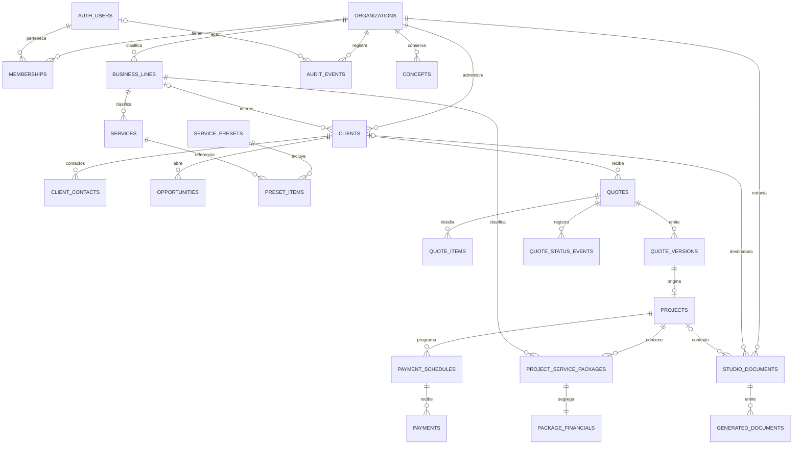

# Modelo implementado

ERD incremental, no modelo completo terminado. Se amplía antes de cargar datos reales.

FK compuestas (organization_id,id) impiden cruces. Auditoría owner/admin; memberships solo titular; alta estudio transaccional RPC. Sin asignación pública de roles.

Dinero: centavos enteros, máximo entero seguro JS; decimal.js y numeric SQL para operaciones exactas. HALF_UP por base/desc. de partida; impuesto una vez sobre suma neta. Porcentaje sobre obra divide entre 100. Inicialmente MXN; otras monedas requieren reglas de conversión explícitas.

Folios: contador por organización/año (zona horaria del estudio), asignación transaccional y unicidad en quote_versions. No truncar al superar 9,999. Se permiten huecos por preparaciones que no culminan, nunca reutilizar folios. Snapshot por edición con folio, cliente, conceptos, precios, textos, totales, opciones/márgenes; excluye costos/horas internos. Versiones emitidas y objetos Storage sin permisos de actualización/eliminación para usuarios de la app.

Preparar/renderizar/subir/finalizar usa almacenamiento de objetos externo; no se presenta como transacción distribuida. Si falla la confirmación, se intenta limpiar solo el objeto preparado, jamás uno emitido. Metadata pendiente queda trazable; mantenimiento/recolección de preparaciones abandonadas sigue pendiente. Aceptar cotización y crear proyecto/paquetes/obligaciones SÍ ocurre en una sola transacción SQL.

Los presupuestos netos de paquetes están en una tabla financiera separada: colaboradores/lectores consultan alcances sin recibir precios/costos. Pagos efectivos son independientes de obligaciones; reverso conserva fila original y motivo.

Documentos independientes tienen borrador versionado y snapshots canónicos propios. Cliente/proyecto opcionales; un proyecto determina su cliente y se rechazan contextos incompatibles. El contexto, contenido y fecha quedan congelados al preparar cada versión. Folios DOC y COT comparten contador transaccional por organización/año con prefijos distintos; se permiten huecos, no se exige secuencia independiente de cada tipo.

Las políticas de Storage se ampliaron de forma aditiva para reconocer también generated_documents, conservando bloqueos de actualización y borrado de todos los PDFs emitidos. Los mismos tests de cotizaciones se ejecutan tras la ampliación.
